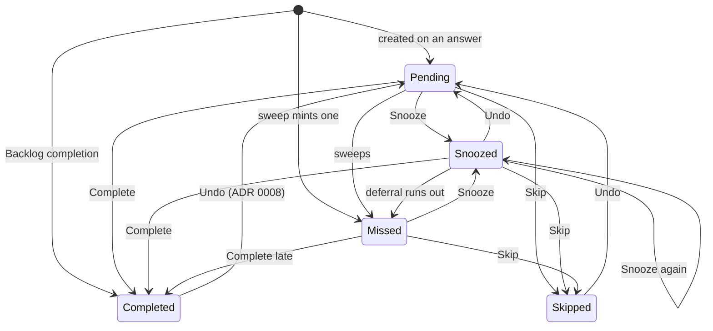
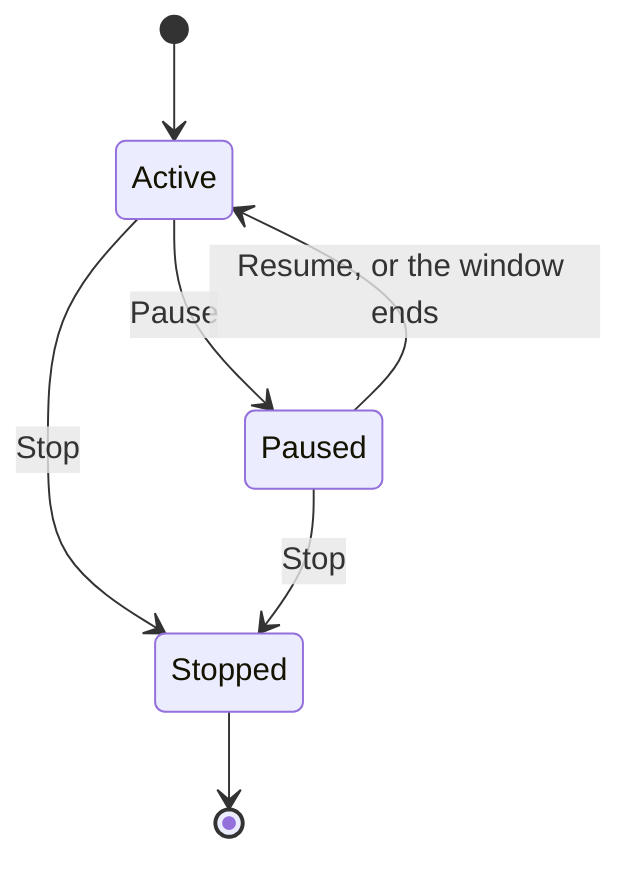

# State machines are written down

TaskRx is full of lifecycles: a Reminder Instance moves between answer statuses, a Reminder
is active, paused or stopped, a queued change waits, retries and dead-letters, an alarm is
desired, armed, degraded or fired. None of that was ever written as a state machine. It was
recomputed at each surface from an enum and a handful of booleans, and the surfaces agreed by
coincidence. A new screen, a new answer path or a new writer could only learn the rules by
reading all the old ones, and nothing stopped it from inventing an edge the domains did not
have.

This ADR makes the rules explicit. Every lifecycle is named, its states and legal moves are
stated in `:core` as pure functions, and the surfaces read those functions instead of
re-deriving them. The catalog below is the whole set: the machines that are now executable,
and the ones that were already sealed types and only needed naming.

## Decision

1. Make a lifecycle executable when more than one surface acts on it. It goes in `:core`, is
   pure, and is gated at 100% coverage like every other rule.
2. The machine answers two distinct questions, and keeps them distinct:
   - **What may the person do?** — the actions a screen offers, derived from the current state.
   - **What may the store hold?** — whether a rewrite from one state to another is legal at
     all. This is broader, because internal writers (a batch, an import, the sync repair) must
     not be told a legal write is impossible just because the UI would not offer it.
3. A surface never spells a `kind == Medication && schedule !is AsNeededTimes` or a
   `status in setOf(...)` of its own again. If it needs a rule, it gets it from `:core`.
4. Already-explicit machines (a `sealed interface` of states plus the one function that
   projects the next state) are left alone; they are recorded here so the next person finds
   them.

## The machines

### 1. Reminder Instance lifecycle — `core/domain/InstanceLifecycle.kt`

States: `Pending`, `Snoozed`, `Missed`, `Completed`, `Skipped`.

Two questions, two functions:

- `availableActions(status)` and `actionTarget(action, from)` — what the answer screen, the
  timeline and the batch offer. A `Missed` row offers the three answers and no Undo (it is
  answered, not undone); a `Snoozed` row offers all four; a `Completed` row offers Undo and a
  correction of its taken time.
- `allowsInstanceTransition(from, to)` — what the store accepts. A row may always be rewritten
  to the status it already has, so every answer is idempotent. The edges that are not
  self-transitions are the diagram above, plus the one widening it keeps: a row created with
  `from = null` may take any status, because the minting rule already decided it.

`ANSWERABLE_STATUSES` (`Enums.kt`) and `UNDOABLE_STATUSES` (`undo/Undo.kt`) are now derived
from this file, so the repository, the timeline lookup, the undo gate and the push shapes
cannot drift apart. `ReminderInstancesRepository.updateStatus` enforces the table inside its
transaction and names the refused pair in the exception.

### 2. Reminder lifecycle — `core/domain/ReminderLifecycle.kt`

States: `Active`, `Paused(window)`, `Stopped`. Pausing is a window (ADR 0009), so the paused
state carries the live window rather than a flag.

- `reminderPhase(reminder, now)` — the state. A live window (running, or waiting to start) is
  `Paused`; an `active = false` row is `Stopped` whatever windows it still carries; a finished
  window leaves the row `Active` while the sweep can still read it.
- `reminderActions(reminder, phase)` — Pause for a live scheduled medication, Resume for a
  paused one (worded "Resume" or "Cancel pause"), Stop in both live states. The rule about
  what may be paused moved here out of the Reminders row, which used to spell out the Kind and
  the Schedule check itself.

### 3. Sync queue entry lifecycle — `core/sync/QueueLifecycle.kt`

States: `Waiting`, `DeadLettered`. "In flight" is not stored — it is the push worker's mutex,
so a crash mid-drain leaves the entry `Waiting` rather than stranded.

- `afterFailure(attemptsBefore)` returns the next attempt count, the next phase, and the pause
  before the drain looks again: `Retry` for the first four failures, `DeadLetter` on the fifth
  (`MAX_ATTEMPTS`, data-flow rule 6). The worker used to write the `isDeadLetterDue` test and
  the `backoffMillis` call as two separate expressions; now it reads one value.

### 4. Notification arming — `core/notifications/Reschedule.kt`

States per notification: *desired* (in the Tier's computed set), *armed* exact, *armed*
degraded, *fired and answered*. `planReschedule(desired, armed, exactAllowed, rearm)` is the
transition function: cancel what no desired set contains (never a snooze), create what is
missing, re-create anything on a Tier whose alarms a reboot or update lost, and move a dose
between exact and degraded as the permission is granted or revoked. The delivery table
(`deliveryFor`) is the per-Tier half of the same machine.

### 5. Permission gate — `core/notifications/PermissionState.kt`

States: `Undetermined` (never asked, or asked and dismissed), `Authorized`, `Partial`
(notifications yes, exact alarms no), `Denied`. `derivePermissionStatus` maps the platform's
numbers onto it, `shouldRequestNotificationPermission` is the one state transition that
raises the OS prompt, and `derivePermissionGap` turns a state into what the person is told.
The `asked` flag exists because `undetermined` before and after a dismissed prompt is the same
platform state and calls for opposite behaviour.

### 6. Session lifecycle — `auth/AuthGateway.kt` and `Session.kt`

States: `Loading`, `SignedOut`, `SignedIn(userId)`. Already a sealed type; `Session.follow`
is the transition function, moving `CurrentUser` and re-arming notifications when whose day it
is changes.

### 7. Entry and save flows — the ViewModels

Already sealed where it matters and now recorded:

- Add by typing — `ui/add/AddViewModel.kt`: a phrase enters, a draft comes back (`understood`
  or the fallback), is edited, then `saving`, then `saved` or `error`. `readPhrase` guarantees
  there is always a draft, so there is no empty state.
- Hand entry and edit — `NewReminderViewModel`, `EditReminderViewModel`: `Loading`/`Editing`
  (sealed) plus `saving`/`saved`/`error`.
- Answer — `ui/answer/AnswerViewModel.kt`: `AnswerState` (`Loading`, `InvalidLink`, `Failed`,
  `Loaded`) plus `Action` (`Idle`, `Completing`, `Skipping`, `Snoozing`, `Undoing`, `Done`).
- Drug search — `ui/search/DrugSearchViewModel.kt`: `SearchStatus` (`Idle`, `Searching`,
  `Unavailable`, `Failed`, `Done`).
- Auth screens — `AuthViewModel`: mode plus the two email-then-code steps.

### 8. As-needed medication — `core/asneeded/AsNeeded.kt`

`AsNeededStatus` with `AsNeededWait` (`Gap`, `Limit`): no dose yet, waiting on the gap, waiting
on the 24 hour limit, ready, or out of its one-hour card window. `showsOnToday` is the
transition into and out of the card.

### 9. Refill warning — `core/refill/Projection.kt` and `Reconcile.kt`

`RefillProjection` is `Unprojectable(reason)` or `RefillOutlook`. `reconcileRefills` is the
transition between no warning, a raised (standing) Refill Reminder, and a retired one.

### 10. Missed sweep — `core/sweep/Planner.kt`

For each moment out of time: no row (mint `Missed`), a `Pending` row (settle it), or a
`Snoozed` row whose deferral ran out (settle it). An answer of any kind blocks the moment.

## Consequences

- **UX.** Every surface offers the same actions for the same state, because they read one
  table. A row cannot say "Paused" while offering "Pause".
- **DX.** A new answer, pause or sync path implements against the named transitions instead of
  copying an enum check. An invalid write fails with the rule's name, not an enum pair.
- **AX.** The catalog above plus the pure functions give an agent a single place to read before
  changing a lifecycle, and the tests pin the edges.
- The two questions (what the person may do, what the store accepts) stay separate on purpose;
  collapsing them would either hide edges internal writers need or offer the person actions
  that make no sense.
